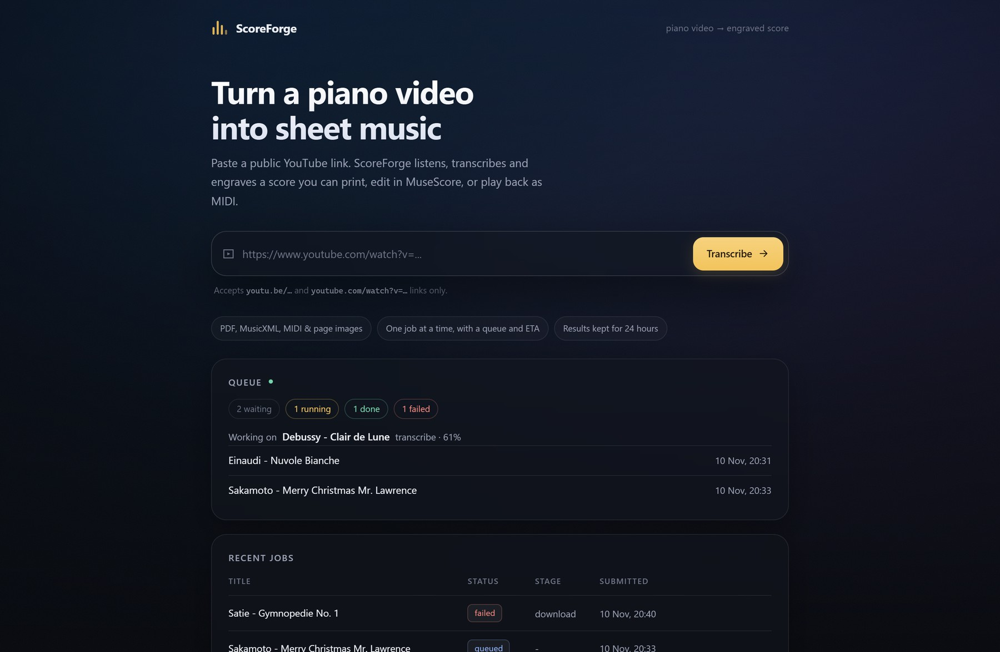
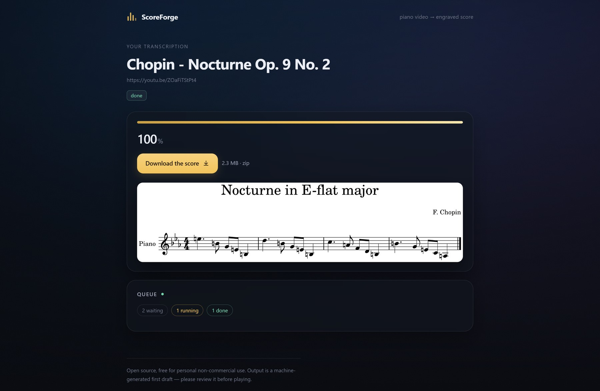

# ScoreForge

**Turn a piano video into engraved sheet music.**

> ### ▶ [Try it live at **scoreforge.toliga.com**](https://scoreforge.toliga.com)
>
> No account, no install: paste a YouTube link and download the finished score
> a few minutes later. (Shared demo server, so the queue can be busy.)

Paste a public YouTube link; ScoreForge listens to the performance, transcribes
it and engraves a printable score. You get a **PDF**, **MusicXML**, a
**MuseScore project**, **MIDI** and page images, packaged in one zip.

[](https://github.com/tustunkok/scoreforge/actions/workflows/ci.yml)
[](https://github.com/tustunkok/scoreforge/actions/workflows/publish.yml)
[](LICENSE)
[](pyproject.toml)
[](https://github.com/tustunkok/scoreforge/pkgs/container/scoreforge)
[](https://semver.org/)
[](https://scoreforge.toliga.com)



---

## Why

Turning a recording into notation is fiddly: you need an audio frontend that
finds the notes, a model that decides which hand played what and how long each
note lasts, and an engraver that produces something you can actually read.
ScoreForge wires those stages together behind one command and one small web
app, and keeps the intermediate files so you can inspect every step.

> **It is a machine-generated first draft.** Note durations, hand assignment
> and pedalling are inferred from the audio and are frequently imperfect,
> especially with pedal-heavy playing. Expect to fix things in MuseScore.



<sub>A finished job. The preview is the first engraved page of <i>Blue
Bossa</i>, transcribed from [this
performance](https://youtu.be/lTpl_6Moo24) — pedalling, dynamics and all.</sub>

## What you get

| Artifact | Why you want it |
|---|---|
| `*.pdf` | print it, or read it on a tablet |
| `*.musicxml` | the exchange format - open it in any notation app |
| `*.mscz` | the MuseScore project, ready to edit |
| `*.mid` | the notated performance, for a DAW or a synth |
| `page-*.png` | page images, for a quick look or a web page |

## How it works

```
YouTube URL
   │  yt-dlp                  download, size- and length-capped
   ▼
 audio (44.1 kHz mono)
   │  Transkun V2             audio      → performance MIDI
   ▼
 performance MIDI
   │  DuET                    MIDI       → MusicXML + score MIDI
   ▼
 MusicXML
   │  MuseScore 4             notation   → PDF / MSCZ / PNG pages
   ▼
 scoreforge-<title>.zip
```

Every stage reports progress, so the web UI can show a percentage, the current
stage and a time estimate instead of a spinner.

## Quick start

**Just want to try it?** Use the hosted demo at
[scoreforge.toliga.com](https://scoreforge.toliga.com) - nothing to install.
There is no account and no cookie; the only input accepted is a YouTube link in
one of the two shapes below, and results are deleted after a day.

To run your own instance, continue below.

### From source

Requirements for a local checkout: **Python 3.11+**,
[uv](https://docs.astral.sh/uv/), `ffmpeg`, `yt-dlp` and **MuseScore 4**.
The first four come from your package manager; MuseScore 4 is GPL, so it is not
committed to this repository - install it from
[musescore.org/download](https://musescore.org/download) and set
`SCOREFORGE_MUSESCORE` if it is not in a standard location.

**Using Docker? You do not need to install anything** - the image already
contains ffmpeg and MuseScore 4 (see [Docker](#docker)).

```bash
git clone https://github.com/tustunkok/scoreforge.git
cd scoreforge
uv sync --extra web
uv run scoreforge doctor          # checks every dependency, and *runs* MuseScore
```

Convert a single video:

```bash
uv run scoreforge convert https://youtu.be/ZOaFiTStPt4 -o out
```

Or run the web app:

```bash
uv run scoreforge serve --host 127.0.0.1 --port 8000
```

The server handles **one job at a time** - transcription is CPU bound, and
running several in parallel only makes every one of them slower. The queue is
persistent (SQLite), so a restart does not lose submissions, and the job page
shows the position and an ETA. Submitting the same video again while its result
is still alive returns the existing job.

### Configuration

Every setting has an environment variable; all of them are optional.

| Variable | Default | Meaning |
|---|---|---|
| `SCOREFORGE_DATA_DIR` | `data` | jobs, artifacts and the SQLite file |
| `SCOREFORGE_DEVICE` | `cpu` | `cpu` or `cuda` |
| `SCOREFORGE_LOG_LEVEL` | `INFO` | `DEBUG` … `CRITICAL` |
| `SCOREFORGE_LOG_FILE` | - | also write to a rotating file |
| `SCOREFORGE_RESULT_TTL_HOURS` | `24` | how long a finished result survives |
| `SCOREFORGE_RATE_LIMIT` / `_RATE_WINDOW` | `5` / `3600` | submissions per client per window |
| `SCOREFORGE_MAX_QUEUE_DEPTH` | `20` | refuse work beyond this backlog |
| `SCOREFORGE_MAX_JOBS_ON_DISK` | `200` | storage cap for retained jobs |
| `SCOREFORGE_MIN_FREE_MB` | `1024` | stop accepting work below this free space |
| `SCOREFORGE_TRUST_PROXY` | off | honour `X-Forwarded-For` (proxy only) |
| `SCOREFORGE_ALLOWED_HOSTS` | any | comma-separated `Host` allow-list |
| `SCOREFORGE_PUBLIC_ORIGIN` | - | public origin(s) accepted for form posts behind a proxy |

## Docker

A Linux **amd64** image is published to
[`ghcr.io/tustunkok/scoreforge`](https://github.com/tustunkok/scoreforge/pkgs/container/scoreforge)
on every push to `master`, tagged `latest`, with the release version and with
the short commit SHA:

```bash
docker compose pull && docker compose up -d
curl http://localhost:8766/healthz      # {"status":"ok","version":"1.0.2"}
```

The image bundles ffmpeg and MuseScore 4 and bakes in the model weights, so a
restart costs nothing and there is nothing to install on the host.

> **amd64 only.** MuseScore's official Linux release is an x86_64 AppImage, so
> the image will not build or run on arm64 hosts - including a 64-bit
> Raspberry Pi. On such a host, run the app from a source checkout and point
> `SCOREFORGE_MUSESCORE` at a MuseScore build of your own.

To build it yourself:

```bash
docker compose build
```

## Running it publicly

There are no accounts and no cookies, so the input path is deliberately narrow.

**Only two link shapes are accepted:**

```
https://youtu.be/ZOaFiTStPt4
https://www.youtube.com/watch?v=ZOaFiTStPt4
```

Everything else - other hosts, `http://`, Shorts, playlists, extra query
parameters, private, live or over-long videos - is rejected. The raw value is
written to the `scoreforge.abuse` log, aggregated to **one line per client per
minute** so that a hostile client cannot flood the log.

On top of that the public build:

* limits request bodies to 2 KB, refuses cross-site form posts and sets a
  strict CSP with `frame-ancestors 'none'`
  ([behind a reverse proxy](#behind-a-reverse-proxy), set
  `SCOREFORGE_PUBLIC_ORIGIN` or form posts are refused);
* rate-limits submissions per client address, caps the queue depth, and
  refuses work when the data volume is short on space;
* downloads with `--max-filesize` and hard timeouts, and rejects live streams
  and sources whose length is unknown;
* never runs a user-supplied local path (only the CLI may name a file);
* runs as UID 10001 with a read-only root filesystem, no capabilities and
  `no-new-privileges`.

Set `SCOREFORGE_TRUST_PROXY=1` **only** behind a reverse proxy that sets
`X-Forwarded-For`; otherwise every client looks like the proxy. Set
`SCOREFORGE_ALLOWED_HOSTS` to your domain so a poisoned `Host` header cannot be
used against you.

## HTTP API

| Route | Purpose |
|---|---|
| `GET /` | submit form, queue and recent jobs |
| `POST /submit` | queue a video (`url` form field) |
| `GET /job/{id}` | status, ETA and preview |
| `GET /download/{id}` | the zip archive |
| `GET /preview/{id}` | first engraving page as JPEG |
| `GET /api/jobs` | queue snapshot as JSON |
| `GET /api/job/{id}` | one job as JSON |
| `GET /healthz` | liveness probe, includes the version |

### Behind a reverse proxy

The cross-site guard compares the browser's `Origin` with the `Host` header.
A proxy usually rewrites `Host` to an internal name, so tell ScoreForge what
public origin(s) to accept, and enable the forwarded client address at the same
time:

```yaml
environment:
  SCOREFORGE_PUBLIC_ORIGIN: https://scores.example.com
  SCOREFORGE_ALLOWED_HOSTS: scores.example.com
  SCOREFORGE_TRUST_PROXY: "1"
```

Only set `SCOREFORGE_TRUST_PROXY` when a proxy you control sets
`X-Forwarded-For`; otherwise a client could choose its own rate-limit bucket.
Direct deployments (no proxy) need none of these.

## Development

```bash
uv sync --extra web --extra dev
uv run pytest -q          # 134 tests
uv run ruff check .
```

The project is developed test-first; `CONTRIBUTING.md` explains the module
layout and the commit message style.

## Versioning

Releases follow [Semantic Versioning](https://semver.org/). `pyproject.toml`
is the source of truth and `scoreforge.__version__` mirrors it; a test fails if
they ever disagree.

```bash
uv version --bump patch     # 1.0.2 → 1.0.3  (updates pyproject.toml + uv.lock)
git commit -am "chore(release): 1.0.3"
git tag v1.0.3 && git push origin master --tags
```

A `v*` tag whose number does not match `pyproject.toml` fails the publish
workflow, so the image tag can never disagree with the code it was built from.

## Licensing

* ScoreForge's own code: **MIT** - see [LICENSE](LICENSE).
* [DuET](https://github.com/wei-zeng98/DuET) (notation): MIT code, but its
  **weights are CC BY-NC 4.0**.
* [Transkun](https://github.com/Yujia-Yan/Transkun) (audio frontend): MIT.

Because of the weights' non-commercial terms, **output is for personal,
non-commercial use only**. Details in [NOTICE.md](NOTICE.md).
